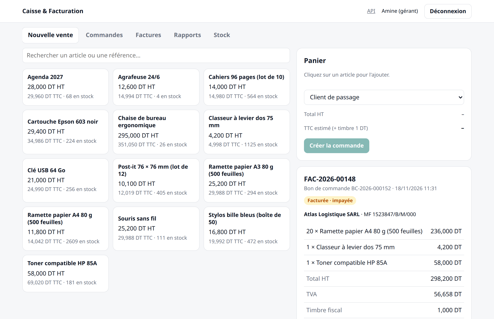
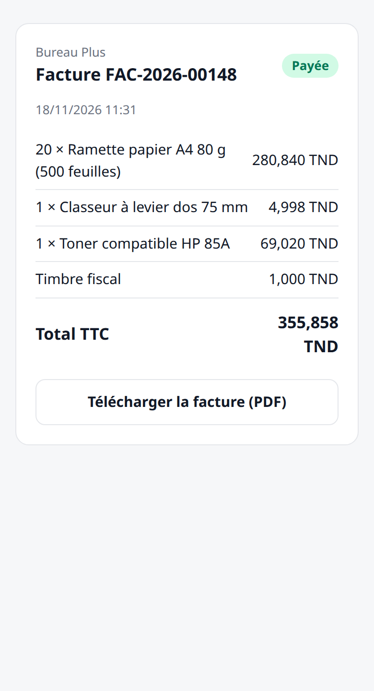
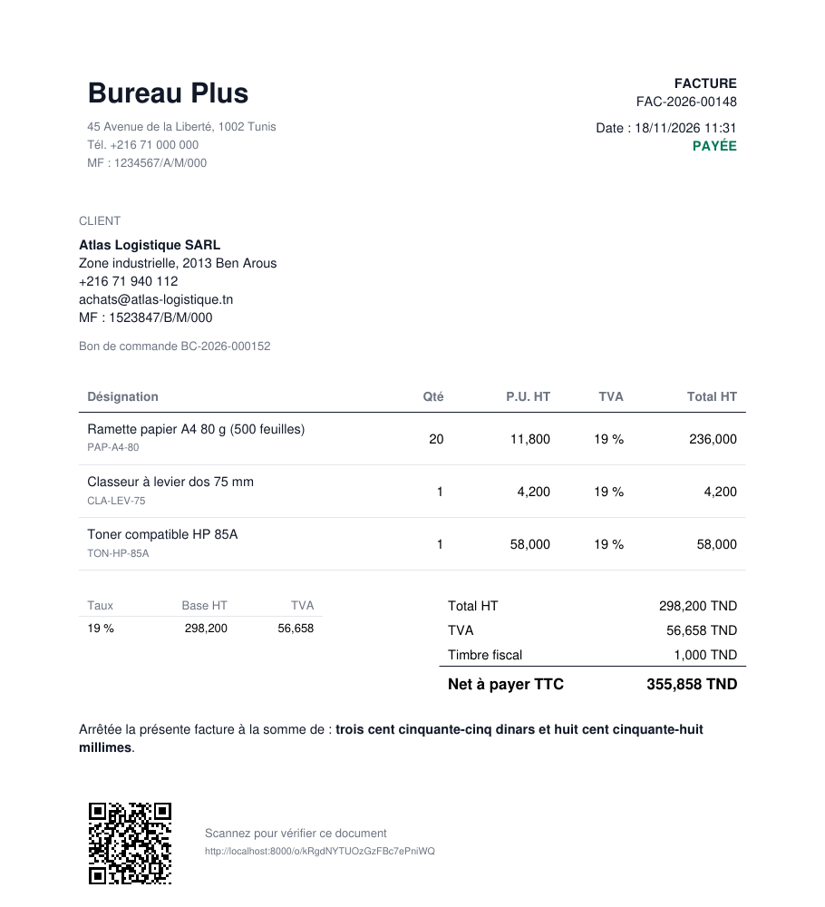
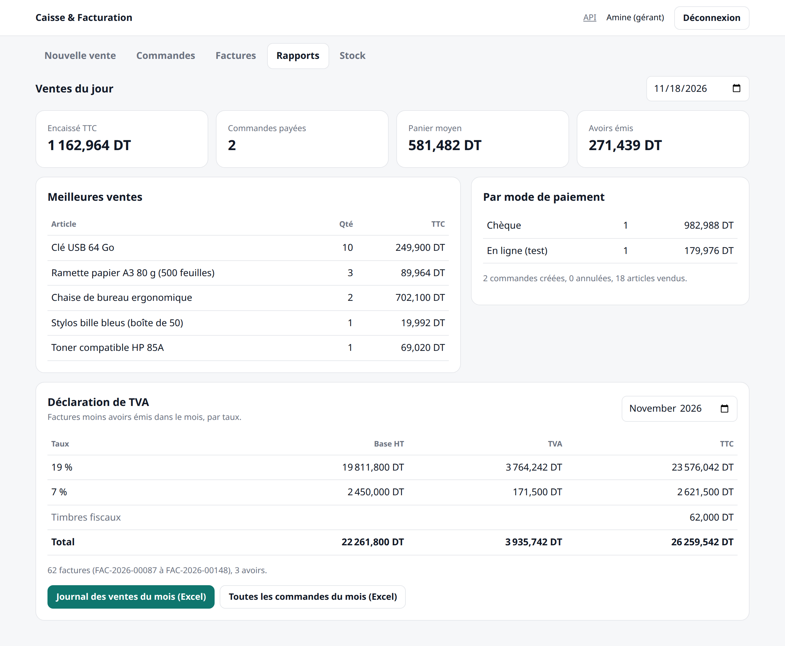
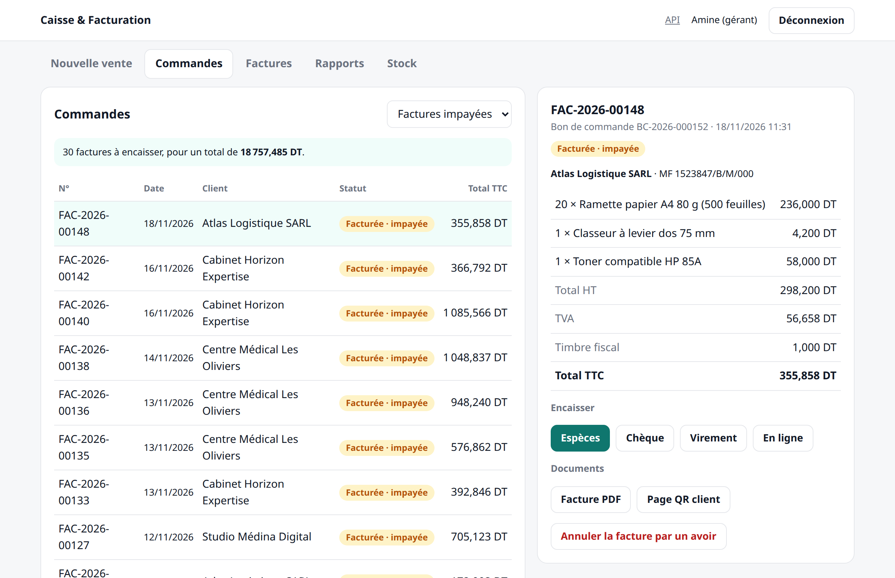
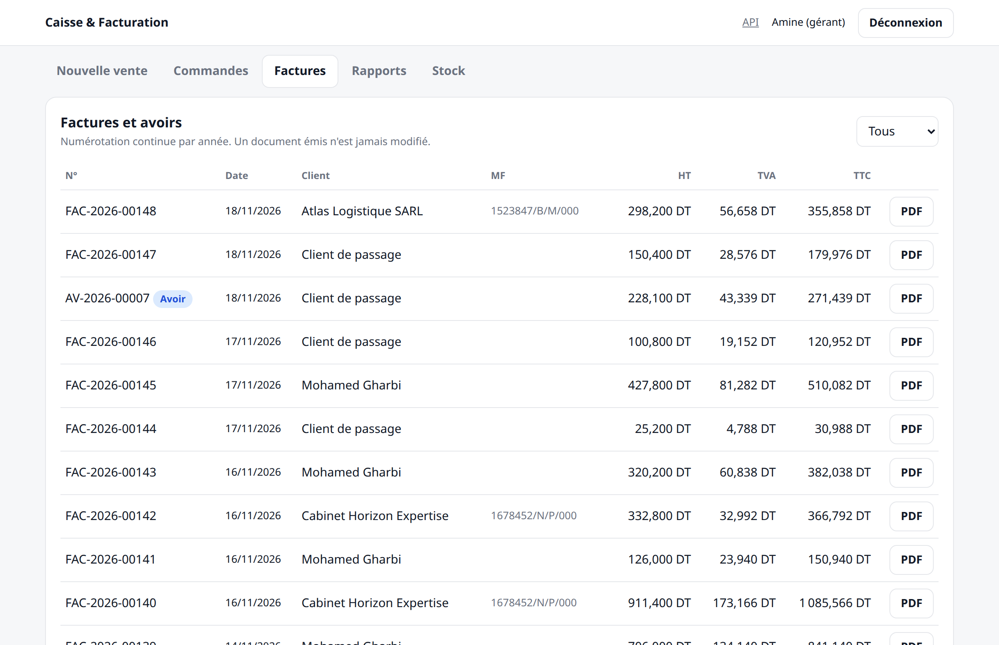
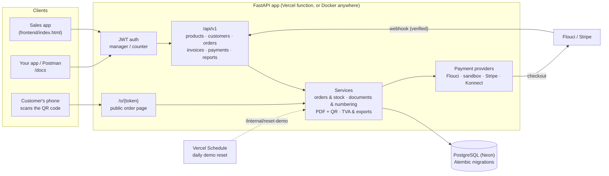

<div align="center">

# Order & Invoice API

### Orders, invoices that pass an accountant's eye, QR payments and the monthly TVA.

The backend a Tunisian shop or distributor needs: take an order, issue a proper invoice (or a<br/>
credit note), get paid in cash, by cheque, transfer or online, and hand the accountant a clean<br/>
sales journal at the end of the month.

<br/>

[](https://order-invoice-api.vercel.app/)
&nbsp;
[](https://order-invoice-api.vercel.app/docs)
&nbsp;
[](https://github.com/MedAmine-SUDO/order-invoice-api/actions/workflows/ci.yml)


<br/>



</div>

<br/>

## Try it in 30 seconds

| | |
| --- | --- |
| 🖥️ **The app (in French)** | [order-invoice-api.vercel.app](https://order-invoice-api.vercel.app/): click **Démo gérant**, then **Se connecter** |
| 📖 **Swagger docs** | [order-invoice-api.vercel.app/docs](https://order-invoice-api.vercel.app/docs): click **Authorize** |
| 👤 **Demo logins** | `admin@demo.tn` / `demo1234` (manager: everything) · `cashier@demo.tn` / `demo1234` (counter: sales only) |
| 📮 **Postman** | import [`postman/order-invoice-api.postman_collection.json`](postman/order-invoice-api.postman_collection.json) and run it top to bottom |

The demo is **Bureau Plus**, an office-supplies distributor in Tunis: company customers with their
*matricule fiscal*, six weeks of counter sales, invoices paid by cheque or transfer, a few still
unpaid, and some credit notes. It resets every day, so feel free to break things. (Names, tax ids
and VAT rates in the demo data are illustrative.)

<br/>

## ✨ What it does

- 📄 **Documents done the way an accountant expects.** An unpaid order is a *bon de commande*
  (`BC-…`). The **invoice** (`FAC-2026-00001`) is issued at payment, or on delivery for account
  customers, with **one gap-free number sequence per year**: two tills paying at the same second
  wait for each other instead of skipping or reusing a number. An issued invoice is never changed or
  deleted; it is cancelled by a **credit note** (`AV-2026-00001`) that cites it and gives the reason.
- 🇹🇳 **Tunisian details.** Amounts in millimes, VAT per product and broken down by rate on the
  invoice, the **1 DT timbre fiscal**, your *matricule fiscal* and the customer's, the customer frozen
  as they were on the invoice date, and *« Arrêtée la présente facture à la somme de… »* in words.
- 🏢 **Counter sales and account customers.** Pay at the counter (cash, cheque, transfer, online) and
  the invoice is issued on the spot. Or invoice a company now, get paid in 30 days, and follow the
  **unpaid invoices** in one list with the total still due.
- 📱 **A QR code on every document.** It opens a mobile page with the order's status and a
  **Payer en ligne** button while it's unpaid. It uses a random token, so ids are never exposed.
- 💳 **Online payments with Flouci.** Customers pay by bank card or Flouci wallet. Flouci's
  webhooks are signature-checked and every payment is confirmed with Flouci before the order is
  marked paid; a customer can't pay twice, and a late payment on a settled order is flagged for a
  refund. One setting switches to **Stripe** (test mode), **Konnect**, or the built-in **sandbox**
  that needs no account. The live demo uses the sandbox; the Flouci integration follows Flouci's
  API documentation and is tested against a simulated Flouci API, ready for a merchant's own keys.
- 📊 **The numbers the business needs.** Daily takings (by payment method, top products, credit
  notes) and the **monthly TVA by rate**, invoices minus credit notes, ready for the return.
  Exports open straight in Excel in French (`;` and decimal comma): the **sales journal**
  (*journal des ventes*) with base and VAT per rate, and the full list of orders.
- 📦 **Stock that stays right.** Reserved when the order is created, with row locks so two people
  can't sell the last unit twice; given back on cancellation or credit note; every movement logged.
- 🔐 **Two roles.** The manager handles products, credit notes, TVA and exports; the counter sells.

<table>
<tr>
<td width="34%"></td>
<td width="33%"></td>
<td width="33%"></td>
</tr>
<tr>
<td align="center"><sub>1. The customer scans the invoice</sub></td>
<td align="center"><sub>2. Pays (sandbox gateway here)</sub></td>
<td align="center"><sub>3. The invoice shows as paid</sub></td>
</tr>
</table>

<br/>

<table>
<tr>
<td width="50%"></td>
<td width="50%"></td>
</tr>
<tr>
<td align="center"><sub>The invoice PDF</sub></td>
<td align="center"><sub>Daily sales and monthly TVA</sub></td>
</tr>
<tr>
<td width="50%"></td>
<td width="50%"></td>
</tr>
<tr>
<td align="center"><sub>Unpaid invoices</sub></td>
<td align="center"><sub>Invoices and credit notes</sub></td>
</tr>
</table>

<br/>

## 🏗️ Architecture



**One order's life:** `POST /orders` locks the product rows, checks stock, snapshots the prices and
computes VAT per line plus the stamp: that's the *bon de commande*. When the payment is confirmed (or
when you invoice an account customer), the invoice takes the next number in the year's sequence,
inside the same transaction. Undoing it later issues a credit note; nothing is ever edited.

```
app/
├── main.py              FastAPI app, CORS, Swagger text, health check
├── models.py            users, customers, products, stock_movements, orders, order_items,
│                        payments, invoices (and credit notes), document_sequences
├── schemas.py           request/response models (money as 3-decimal strings)
├── api/routes/          one file per resource + public.py (QR page, sandbox checkout)
├── services/
│   ├── orders.py        totals, stock, cancellation, credit notes, settling payments
│   ├── documents.py     invoice and credit note issuing, gap-free yearly numbering
│   ├── invoice.py       the three PDFs (ReportLab) and the QR code (segno)
│   ├── words.py         amounts in French words
│   ├── reports.py       daily summary, monthly TVA, sales journal and order exports
│   └── payments/        flouci.py · mock.py · stripe.py · konnect.py behind one interface
└── seed.py              the demo distributor
alembic/                 migrations, including a data migration (CI checks they match the models)
tests/                   82 tests, run on PostgreSQL in CI
frontend/index.html      the sales app, in French: no build step, one file
postman/                 ready-to-run collection
```

<br/>

## 🚀 Run it

**With Docker** (the only requirement):

```bash
git clone https://github.com/MedAmine-SUDO/order-invoice-api.git
cd order-invoice-api
docker compose up
```

Open http://localhost:8000. Migrations run and the demo data loads on first start.

**For development** (with [uv](https://docs.astral.sh/uv/)):

```bash
uv sync
cp .env.example .env                  # point DATABASE_URL at your Postgres
uv run alembic upgrade head
uv run python -m app.seed             # optional demo data (--reset to start over)
uv run uvicorn app.main:app --reload
uv run pytest                         # SQLite by default; set TEST_DATABASE_URL for Postgres
```

### Deploy on Vercel + Neon (free)

The live demo runs as a Vercel serverless function with a [Neon](https://neon.tech) PostgreSQL database:
no server to keep running, and the first request after a quiet night answers in a second or two.

1. **Vercel → Add New → Project**, import this repo. FastAPI is detected; no build settings to change.
2. **Storage → Create → Neon**, connect it to the project. This sets `DATABASE_URL` (pooled) and
   `DATABASE_URL_UNPOOLED` for you. Put the function in the same region as the database
   (**Settings → Functions**).
3. **Settings → Environment Variables:** `ENVIRONMENT=production`, `SECRET_KEY` (a long random string),
   `CRON_SECRET` (another one, enables the daily demo reset). `PUBLIC_BASE_URL` can stay empty: the
   production URL is used.
4. **GitHub → Settings → Secrets → Actions:** add `NEON_DATABASE_URL_UNPOOLED`. On every push to
   `main`, CI applies the migrations and loads the demo data if the database is empty. The
   **Reset demo** workflow starts the demo over on demand.
5. Redeploy. [`vercel.json`](vercel.json) defines a Vercel Schedule that calls `/internal/reset-demo`
   every day at 11:00 Tunis time, so whatever visitors change in the demo doesn't last. Check it under
   **Schedules** in the project, where **Run Schedule** runs it on demand and each run is listed.

In serverless mode the app opens one connection per request (`NullPool`) and lets Neon's pooler do the
pooling. It also disables prepared statements, which transaction-mode poolers don't support.

### Any other PostgreSQL

It is plain PostgreSQL, so the same image runs on Railway, Render, Fly.io, AWS or your own server
(`docker compose up` is all it takes), and the same code works with **Supabase**: use the
*transaction pooler* connection string (port 6543) as `DATABASE_URL`, and the direct one for migrations.

<br/>

## ✅ Production habits

| | |
| --- | --- |
| 🧪 **Tests** | 82 pytest tests: totals and rounding, gap-free numbering (including across New Year in Tunis time), credit notes, customer snapshots, monthly TVA, the sales journal, stock races, roles, PDFs, each payment gateway with a faked API, webhook signatures (forged, replayed, or with no secret configured), double payment, amounts in words |
| 🔁 **CI** | GitHub Actions: lint, migrations up, `alembic check` (models and migrations agree), migrations down, tests on PostgreSQL 16, Docker build and a smoke test of `docker compose up`, then migrations on the production database |
| 🗃️ **Migrations** | Schema changes ship with their data migration: when invoices became separate documents, existing paid orders got their invoices, numbered in payment order |
| ⚙️ **Config** | Everything comes from environment variables ([`.env.example`](.env.example)). The app refuses to start in production with the default secret key |
| 💰 **Money** | `NUMERIC(12,3)` in the database, `Decimal` in Python, strings in JSON: never a float |
| 🕐 **Time** | Stored in UTC and reported in `Africa/Tunis`, so "today" and "this year" mean the shop's |
| 🐳 **Container** | Slim image, non-root user, health check, dependencies cached in their own layer |
| ☁️ **Hosting** | Serverless on Vercel + Neon with connection handling made for it; Docker for everywhere else |

<br/>

## 🔧 Adapt it to your business

Most changes are a setting, not code:

| You want… | Change |
| --- | --- |
| Your name, address and *matricule fiscal* on documents | `BUSINESS_NAME`, `BUSINESS_ADDRESS`, `BUSINESS_PHONE`, `BUSINESS_TAX_ID` |
| Real payments with Flouci | `PAYMENT_PROVIDER=flouci`, `FLOUCI_PUBLIC_KEY`, `FLOUCI_PRIVATE_KEY` (your app's keys from developers.flouci.com; the TEST APP's keys take Flouci's test cards) |
| Konnect instead | `PAYMENT_PROVIDER=konnect`, `KONNECT_API_KEY`, `KONNECT_WALLET_ID`, `KONNECT_BASE_URL`. Written from Konnect's API documentation; not yet run against a live Konnect account |
| Stripe instead | `PAYMENT_PROVIDER=stripe`, `STRIPE_SECRET_KEY`, `STRIPE_WEBHOOK_SECRET`; point the Stripe webhook at `/api/v1/payments/webhooks/stripe` |
| Credit notes that also give back the stamp | `CREDIT_NOTE_INCLUDES_STAMP=true` (check with your accountant) |
| No stamp duty, another VAT rate, another country | `FISCAL_STAMP=0`, `DEFAULT_TAX_RATE`, `CURRENCY`, `TIMEZONE` |
| Your own front end (React, mobile app, POS) | Use the API directly: CORS is configurable with `CORS_ORIGINS`, and the OpenAPI schema is at `/openapi.json` for client generation |

And the common extensions, each a small addition to this structure: quotes (*devis*) that turn into
orders, discounts, partial payments and partial credit notes, payment terms with reminders, sending
documents by e-mail or WhatsApp, or another gateway (Paymee, ClicToPay) as one more file in
`app/services/payments/`.

**About El Fatoora.** This produces PDF invoices. Businesses that must invoice through Tunisia's
electronic invoicing platform (El Fatoora, run by TTN) need that connection added; the invoice data
it would send is all here, issued once and numbered without gaps.

<br/>

## 📮 API at a glance

| Method | Path | Who | What |
| --- | --- | --- | --- |
| `POST` | `/api/v1/auth/login` | anyone | email + password → JWT |
| `GET` | `/api/v1/products` | staff | search, `low_stock=5` filter |
| `POST` | `/api/v1/products/{id}/stock` | manager | delivery or loss, logged |
| `POST` | `/api/v1/orders` | staff | create the order form, reserve stock |
| `POST` | `/api/v1/orders/{id}/payments` | staff | `cash`, `cheque`, `transfer` or `online` (returns `pay_url`); issues the invoice |
| `POST` | `/api/v1/orders/{id}/invoice` | staff | invoice now, get paid later |
| `GET` | `/api/v1/orders?status=pending&invoiced=true` | staff | unpaid invoices |
| `POST` | `/api/v1/orders/{id}/cancel` | staff | cancel an order that was never invoiced |
| `POST` | `/api/v1/orders/{id}/credit-note` | manager | cancel an invoice with a credit note |
| `GET` | `/api/v1/orders/{id}/document.pdf` | staff | order form, or invoice once issued |
| `GET` | `/api/v1/invoices` · `/{id}/pdf` | staff | invoices and credit notes |
| `GET` | `/o/{token}` | public | QR landing page (status, pay, PDF) |
| `GET` | `/api/v1/reports/daily?day=` | staff | the day's summary |
| `GET` | `/api/v1/reports/vat?month=` | manager | TVA by rate for the month |
| `GET` | `/api/v1/reports/sales-journal.csv?start=&end=` | manager | sales journal for the accountant |

Full list with schemas and examples in Swagger at `/docs`.

<br/>

---

<sub>🇫🇷 **API de gestion de commandes et factures avec QR code et paiement en ligne** (FastAPI,
PostgreSQL, Docker) : bons de commande, factures à numérotation continue et avoirs, TVA par taux,
timbre fiscal et matricule fiscal, clients professionnels avec suivi des impayés, paiement en espèces,
chèque, virement ou en ligne (Flouci, Stripe), QR code de suivi et de paiement, déclaration de TVA
mensuelle et journal des ventes pour l'expert-comptable.</sub>
