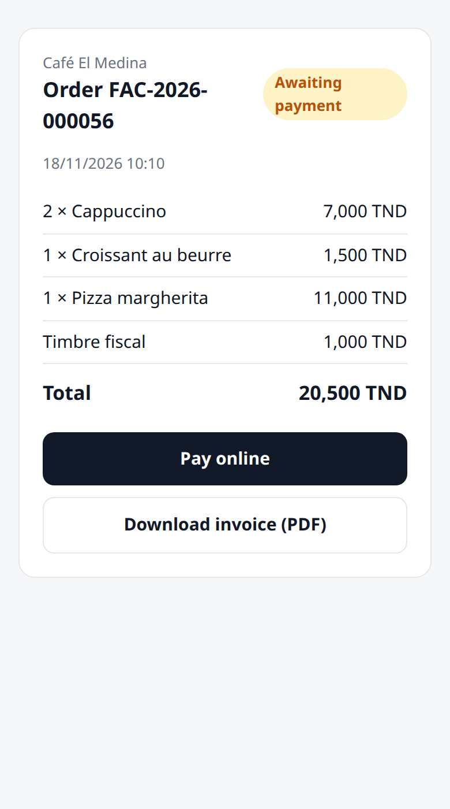
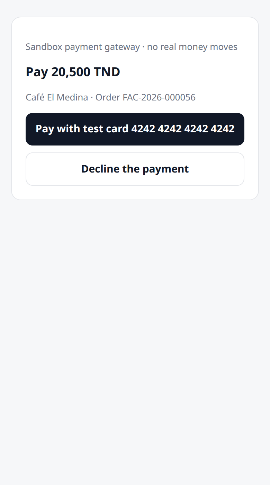
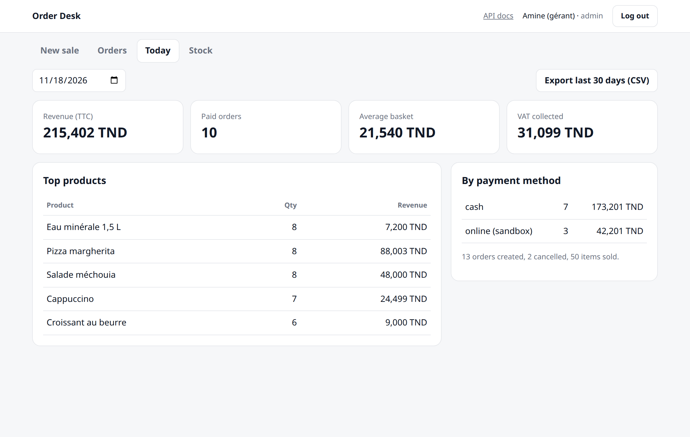
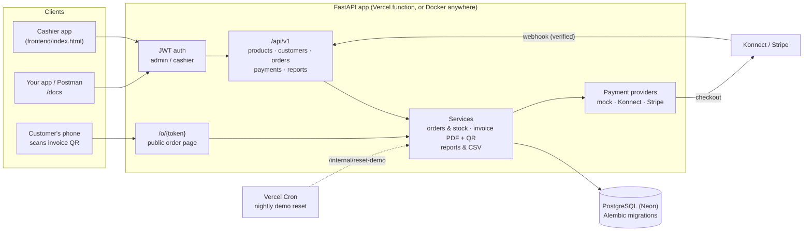

<div align="center">

# Order & Invoice API

### Orders, PDF invoices with a QR code, online payments and a daily sales report.

The backend a shop, café or restaurant needs: take an order, print a proper Tunisian invoice,<br/>
let the customer scan it to pay online, and see the day's takings at closing time.

<br/>

[](#)
&nbsp;
[](https://github.com/MedAmine-SUDO/order-invoice-api/actions/workflows/ci.yml)


<br/>


</div>

<br/>

## Try it in 30 seconds

| | |
| --- | --- |
| 🖥️ **Cashier app** | [`/`](#): click **Demo admin**, then **Log in** |
| 📖 **Swagger docs** | [`/docs`](#): click **Authorize** |
| 👤 **Demo logins** | `admin@demo.tn` / `demo1234` (everything) · `cashier@demo.tn` / `demo1234` (sales only) |
| 📮 **Postman** | import [`postman/order-invoice-api.postman_collection.json`](postman/order-invoice-api.postman_collection.json) and run it top to bottom |

The demo is a café with a menu, three customers and a week of sales already in it. It resets
every night, so feel free to break things.

<br/>

## ✨ What it does

- 🧾 **Orders and stock.** A cashier rings up an order; stock is reserved right away (with row locks, so two tills can't sell the last croissant twice) and given back if the order is cancelled. Every stock change is logged with who made it and why.
- 📄 **Real invoices.** Each order gets a numbered PDF invoice (`FAC-2026-000056`) in French with VAT per product (19 %, 7 %…), the **1 TND timbre fiscal**, your *matricule fiscal* and the customer's. Prices are snapshotted, so editing a product never changes an old invoice.
- 📱 **A QR code that works.** The QR code on the invoice opens a mobile page showing whether the order is paid, with a **Pay online** button while it isn't. It uses a random token, so order ids are never exposed.
- 💳 **Online payments, three ways.** Pick the gateway with one setting: **Konnect** (Tunisian cards, e-DINAR, wallet), **Stripe** (test mode), or the built-in **sandbox**, which needs no account. Webhooks are verified (Stripe signatures are checked, and Konnect statuses are confirmed with Konnect), and a customer can't pay the same order twice.
- 📊 **End-of-day numbers.** `GET /reports/daily` gives revenue, VAT collected, average basket, cash vs. online and the top products, for any day in Tunis time. An admin can export any period as a **CSV** that opens correctly in Excel (accents included) for the accountant.
- 🔐 **Two roles.** Admins manage products, users and exports. Cashiers sell. Logins use JWT.

<table>
<tr>
<td width="34%"></td>
<td width="33%"></td>
<td width="33%"></td>
</tr>
<tr>
<td align="center"><sub>1. The customer scans the invoice</sub></td>
<td align="center"><sub>2. Pays (sandbox gateway here)</sub></td>
<td align="center"><sub>3. The order shows as paid</sub></td>
</tr>
</table>

<br/>

<table>
<tr>
<td width="50%"></td>
<td width="50%"></td>
</tr>
<tr>
<td align="center"><sub>The PDF invoice</sub></td>
<td align="center"><sub>Today's sales</sub></td>
</tr>
</table>

<br/>

## 🏗️ Architecture



**One order's life:** `POST /orders` locks the product rows, checks stock, snapshots prices, computes VAT
per line and the stamp, then gives the order a number and a QR token. A payment is either cash (paid
at once) or a checkout on the gateway; the order turns `paid` only when the gateway confirms it.

```
app/
├── main.py              FastAPI app, CORS, Swagger text, health check
├── models.py            users, customers, products, stock_movements, orders, order_items, payments
├── schemas.py           request/response models (money as 3-decimal strings)
├── api/routes/          one file per resource + public.py (QR page, sandbox checkout)
├── services/
│   ├── orders.py        totals, stock, cancellation, settling payments
│   ├── invoice.py       PDF (ReportLab) and QR (segno)
│   ├── reports.py       daily summary, CSV export, Tunis-time day bounds
│   └── payments/        mock.py · konnect.py · stripe.py behind one interface
└── seed.py              demo café
alembic/                 migrations (CI checks they match the models)
tests/                   53 tests, run on PostgreSQL in CI
frontend/index.html      the cashier app: no build step, one file
postman/                 ready-to-run collection
```

<br/>

## 🚀 Run it

**With Docker** (the only requirement):

```bash
git clone https://github.com/MedAmine-SUDO/order-invoice-api.git
cd order-invoice-api
docker compose up
```

Open http://localhost:8000. Migrations run and the demo data loads on first start.

**For development** (with [uv](https://docs.astral.sh/uv/)):

```bash
uv sync
cp .env.example .env                  # point DATABASE_URL at your Postgres
uv run alembic upgrade head
uv run python -m app.seed             # optional demo data
uv run uvicorn app.main:app --reload
uv run pytest                         # SQLite by default; set TEST_DATABASE_URL for Postgres
```

### Deploy on Vercel + Neon (free)

The live demo runs as a Vercel serverless function with a [Neon](https://neon.tech) PostgreSQL database:
no server to keep running, and the first request after a quiet night answers in a second or two.

1. **Vercel → Add New → Project**, import this repo. FastAPI is detected; no build settings to change.
2. **Storage → Create → Neon**, connect it to the project. This sets `DATABASE_URL` (pooled) and
   `DATABASE_URL_UNPOOLED` for you.
3. **Settings → Environment Variables:** `ENVIRONMENT=production`, `SECRET_KEY` (a long random string),
   `CRON_SECRET` (another one, enables the nightly demo reset). `PUBLIC_BASE_URL` can stay empty: the
   production URL is used.
4. **GitHub → Settings → Secrets → Actions:** add `NEON_DATABASE_URL_UNPOOLED`. On every push to
   `main`, CI applies the migrations and loads the demo data if the database is empty.
5. Redeploy. [`vercel.json`](vercel.json) schedules `/internal/reset-demo` every night, so whatever
   visitors change in the demo is gone by morning.

In serverless mode the app opens one connection per request (`NullPool`) and lets Neon's pooler do the
pooling. It also disables prepared statements, which transaction-mode poolers don't support.

### Any other PostgreSQL

It is plain PostgreSQL, so the same image runs on Railway, Render, Fly.io, AWS or your own server
(`docker compose up` is all it takes), and the same code works with **Supabase**: use the
*transaction pooler* connection string (port 6543) as `DATABASE_URL`, and the direct one for migrations.

<br/>

## ✅ Production habits

| | |
| --- | --- |
| 🧪 **Tests** | 53 pytest tests: totals and rounding, stock races, roles, PDF/QR, each payment gateway with a faked API, webhook signatures (wrong secret, replayed event), double payment, Tunis-time reports, CSV |
| 🔁 **CI** | GitHub Actions: lint, migrations up, `alembic check` (models and migrations agree), migrations down, tests on PostgreSQL 16, Docker build and a smoke test of `docker compose up`, then migrations on the production database |
| ⚙️ **Config** | Everything comes from environment variables ([`.env.example`](.env.example)). The app refuses to start in production with the default secret key |
| 💰 **Money** | `NUMERIC(12,3)` in the database, `Decimal` in Python, strings in JSON: never a float |
| 🕐 **Time** | Stored in UTC and reported in `Africa/Tunis`, so "today" means the shop's day |
| 🐳 **Container** | Slim image, non-root user, health check, dependencies cached in their own layer |
| ☁️ **Hosting** | Serverless on Vercel + Neon with connection handling made for it; Docker for everywhere else |

<br/>

## 🔧 Adapt it to your business

Most changes are a setting, not code:

| You want… | Change |
| --- | --- |
| Your name, address and *matricule fiscal* on invoices | `BUSINESS_NAME`, `BUSINESS_ADDRESS`, `BUSINESS_PHONE`, `BUSINESS_TAX_ID` |
| Real payments with Konnect | `PAYMENT_PROVIDER=konnect`, `KONNECT_API_KEY`, `KONNECT_WALLET_ID`, and `KONNECT_BASE_URL` set to the production API |
| Stripe instead | `PAYMENT_PROVIDER=stripe`, `STRIPE_SECRET_KEY`, `STRIPE_WEBHOOK_SECRET`; point the Stripe webhook at `/api/v1/payments/webhooks/stripe` |
| No stamp duty, another VAT rate, another country | `FISCAL_STAMP=0`, `DEFAULT_TAX_RATE`, `CURRENCY`, `TIMEZONE` |
| Your own front end (React, mobile app, POS) | Use the API directly: CORS is configurable with `CORS_ORIGINS`, and the OpenAPI schema is at `/openapi.json` for client generation |

And the common extensions, each a small addition to this structure: discounts and coupons, table
numbers or delivery addresses for restaurants, an e-mail of the invoice after payment, a kitchen
screen fed by `GET /api/v1/public/orders/{token}`, or another gateway (Flouci, Paymee, ClicToPay)
as a fourth file in `app/services/payments/`.

<br/>

## 📮 API at a glance

| Method | Path | Who | What |
| --- | --- | --- | --- |
| `POST` | `/api/v1/auth/login` | anyone | email + password → JWT |
| `GET` | `/api/v1/products` | staff | search, `low_stock=5` filter |
| `POST` | `/api/v1/products/{id}/stock` | admin | delivery or loss, logged |
| `POST` | `/api/v1/orders` | staff | create, reserve stock, number the invoice |
| `POST` | `/api/v1/orders/{id}/payments` | staff | `cash` or `online` (returns `pay_url`) |
| `POST` | `/api/v1/orders/{id}/cancel` | staff | cancel, give stock back |
| `GET` | `/api/v1/orders/{id}/invoice.pdf` | staff | the PDF invoice |
| `GET` | `/o/{token}` | public | QR landing page (status, pay, PDF) |
| `GET` | `/api/v1/reports/daily?day=` | staff | the day's summary |
| `GET` | `/api/v1/reports/orders.csv?start=&end=` | admin | export |

Full list with schemas and examples in Swagger at `/docs`.

<br/>

---

<sub>🇫🇷 **API de gestion de commandes et factures avec QR code et paiement en ligne** (FastAPI, PostgreSQL,
Docker) : commandes, stock, factures PDF conformes (TVA, timbre fiscal, matricule fiscal), QR code de
suivi et de paiement, paiement en ligne via Konnect ou Stripe, rapport de ventes quotidien et export CSV.</sub>
